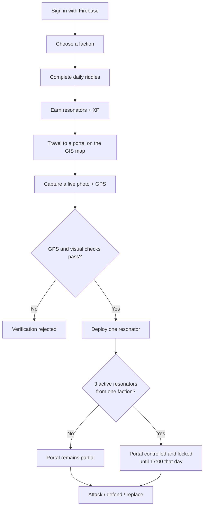
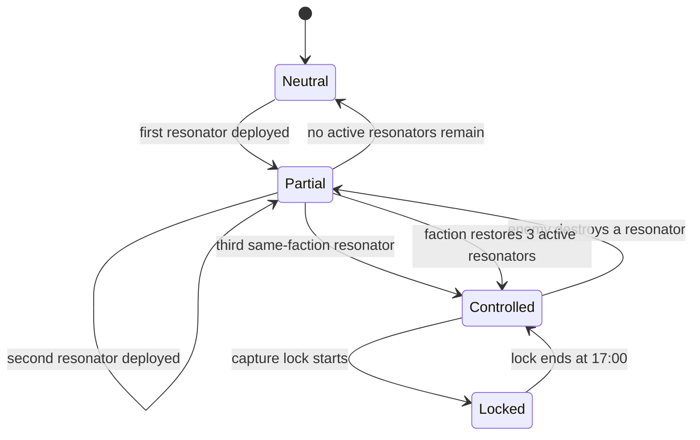
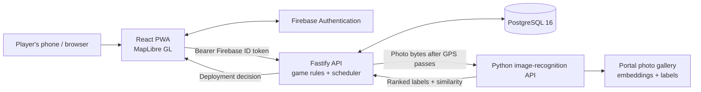
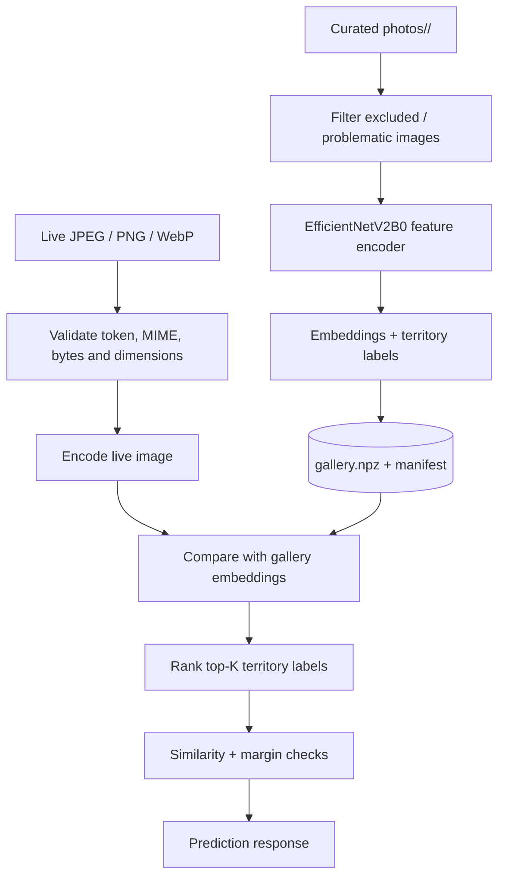
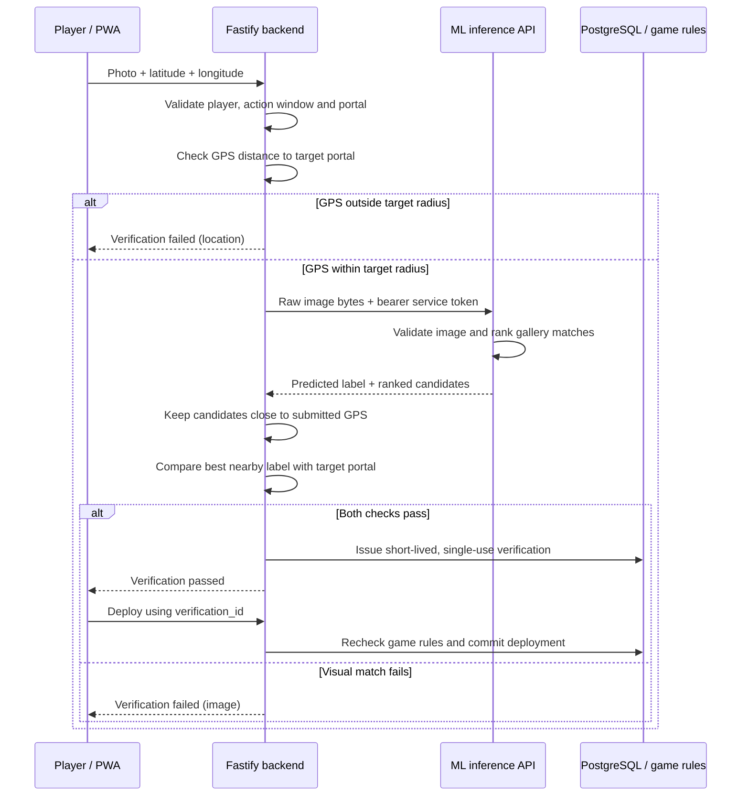

# CampusQuest

> A GIS-powered, mobile-first campus territory-control game where riddles, real-world exploration, image recognition, and teamwork decide who controls the map.

<p align="center">
  
  
  
  
  
  
  
</p>

CampusQuest turns a campus map into a live strategy game. Players join one of two permanent factions — **Red** or **Blue** — solve daily riddles to earn resonators, travel to real locations, and deploy their resonators to capture portals. An API-backed game engine applies the rules, while a computer-vision service checks whether a submitted live photo resembles the claimed portal. GPS range checks and visual recognition must both pass before deployment is allowed.

**Repository:** [samay15jan/CampusQuest](https://github.com/samay15jan/CampusQuest)

---

## Contents

- [At a glance](#at-a-glance)
- [How the game works](#how-the-game-works)
- [System architecture](#system-architecture)
- [Technology stack](#technology-stack)
- [Frontend](#frontend)
- [Backend](#backend)
- [ML image-recognition service](#ml-image-recognition-service)
- [API overview](#api-overview)
- [Local development setup](#local-development-setup)
- [Environment configuration](#environment-configuration)
- [Database backup, restore, and demo data](#database-backup-restore-and-demo-data)
- [Testing](#testing)
- [Security and operational notes](#security-and-operational-notes)
- [Current limitations](#current-limitations)

## Screenshots and user journey

The screenshots below show the main CampusQuest experience, from joining the game to exploring portals and validating a capture. The gallery uses repository-relative image paths so the images stay versioned alongside the documentation.

### 1. Sign-in and onboarding

Players enter through the CampusQuest welcome screen and authenticate with Google using Firebase Authentication. After sign-in, they join a faction and enter the live game.

<p align="center">
  
</p>

### 2. Live GIS map

The mobile map presents the campus as a playable space, with portal markers, resonator counts, faction ownership, event timing, and quick navigation. The desktop view gives a wider operational overview of campus territory and live game state.

<p align="center">
  
  
</p>

### 3. Portal details and capture

Opening a portal shows its location, current faction, level, resonator slots, point value, and capture requirements. A player must be physically near the portal and submit a live photo before the backend can authorize deployment.

<p align="center">
  
</p>

### 4. GPS and ML image verification

The verification flow checks the device location against the portal's allowed radius and submits the captured image for visual matching. The result screen explains which checks passed or failed. A visual mismatch must block capture even when location verification succeeds; the backend remains authoritative.

<p align="center">
  
  
</p>

### 5. Riddles, missions, and territory objectives

Daily riddles connect exploration to real campus landmarks. Missions summarize available portals, current control state, and the actions each faction can take. Correct answers reward resonators, which players deploy at portals to help their faction reach the three-resonator capture requirement.

<p align="center">
  
  
</p>

### 6. Player profile and leaderboard

The profile shows faction identity, XP and level progression, portal activity, and rank. The leaderboard compares players globally or by faction, helping make the territory competition visible to the whole campus.

<p align="center">
  
  
</p>

### How a session moves forward

1. **Sign in:** authenticate with Firebase and select Red or Blue.
2. **Find a target:** explore the GIS map or open a mission to choose a portal.
3. **Solve a riddle:** identify a campus location and earn a resonator.
4. **Go to the real location:** use the portal details and map to navigate to the landmark.
5. **Verify the capture attempt:** provide a live photo and device coordinates; the API checks location and asks the ML service to match the photo.
6. **Deploy:** only a request that passes the required checks can place a resonator.
7. **Coordinate:** the faction works toward three active resonators at the same portal to capture it, then defends or attacks according to the game rules.
8. **Track progress:** XP, levels, portal states, and leaderboard positions reflect the resulting server-side game state.

> **Screenshot assets:** Place the ten supplied screenshots in `docs/screenshots/` using the filenames shown above. GitHub README files support static image galleries, not a native interactive JavaScript carousel.

---

## At a glance

| Area | Implementation |
| --- | --- |
| Experience | Mobile-first, installable Progressive Web App (PWA); desktop live dashboard |
| Map | MapLibre GL with campus portal coordinates and territory state |
| Frontend | React 19, Vite 8, JavaScript, React Router, Tailwind CSS 4 |
| Identity | Firebase Authentication on the client; Firebase Admin token verification on the API |
| Backend API | Node.js 22+, Fastify 5, ES modules |
| Persistence | PostgreSQL 16, SQL migrations and seed data |
| Computer vision | Python 3.11, TensorFlow/Keras, frozen EfficientNetV2B0 feature encoder and image-embedding gallery |
| Deployment | Docker / Docker Compose; optional Cloudflare Tunnel for the inference service |
| Game clock | Campus-local timezone, configurable through `CAMPUS_TZ` (default `Asia/Kolkata`) |

## How the game works

### Player loop



### Portal state model

A portal can be neutral, partially occupied, or controlled. Three active resonators belonging to the same faction capture it. A controlled portal is locked until 17:00 on that day, preventing attacks during the lock period. Outside the lock, a nearby opposing player can destroy one enemy resonator, subject to the attack cooldown; an open slot can then be filled by another deployment.



The server is the source of truth for portal state and game actions; the frontend displays the state returned by the API.

### Implemented game rules

| Rule | Behaviour |
| --- | --- |
| Factions | `red` and `blue`; selected once after sign-in and permanent |
| Weekly event | Monday 09:00 to Friday 17:00 in campus time; weekends are off |
| Playable hours | Monday–Friday, 09:00–17:00; portal windows are configurable |
| Event portals | 10 portals selected for an event from the active master list (typically 14–15 portal records) |
| Riddles | 2 per player per day; multiple-choice, four options; the answer is a portal name |
| Riddle reward | Correct answer grants 1 resonator and XP |
| Deployment | Requires an available resonator, portal-range GPS check, and successful live-photo recognition |
| Deployment limits | One active resonator per player per portal; at most one deployment per player per portal per day |
| Capture | 3 active resonators of one faction; portal is locked until 17:00 that day |
| Attack | Player must be within range; destroys one enemy resonator on a partial/unlocked portal; 60-second cooldown |
| XP | Riddle +100; deploy +50; destroy +30; capture bonus +100; weekly win +500 for each participant of the winning faction |
| Levels | Level `n` begins at `100 × (n − 1)²` lifetime XP |

Game values and portal windows are configurable in the backend. Behaviour documented here reflects the current backend implementation, not an assertion that every planned feature is complete.

## System architecture



**Trust boundary:** Firebase authenticates the user; the backend validates permissions, hours, GPS distance, resonator inventory, cooldowns, and game state. The ML service supplies a visual matching signal only. It does not create game portals or independently authorise a deployment.

## Technology stack

| Layer | Technology | Role |
| --- | --- | --- |
| Frontend | React 19, Vite 8, JavaScript | Single-page application and build tooling |
| Navigation | React Router 7 | Screen routing and protected player pages |
| Maps | MapLibre GL | GIS map, campus portal locations and map layers |
| Styling | Tailwind CSS 4 and project CSS | Responsive/mobile-first UI |
| PWA | Web app install flow and service-worker registration | Installable mobile experience |
| QR utility | `qrcode` | QR code for opening the phone experience from the desktop dashboard |
| Identity | Firebase JS SDK + Firebase Admin SDK | Google sign-in and server-side ID-token verification |
| API | Node.js 22+, Fastify 5 | REST endpoints, validation, auth hooks and game services |
| Database | PostgreSQL 16, `pg` | Users, events, portals, riddles, resonators, XP and activity |
| ML service | Python 3.11, TensorFlow/Keras, NumPy, Pillow | Embedding generation, similarity ranking and inference API |
| Model backbone | EfficientNetV2B0 pretrained on ImageNet | Frozen visual feature encoder |
| Infrastructure | Docker, Docker Compose, persistent volumes | Repeatable services and data persistence |
| Public ML ingress | Cloudflare Tunnel (optional) | Securely expose the inference service without directly publishing its origin |

## Frontend

The application lives in `frontend/`.

- **React + Vite:** client-side application, JavaScript ES modules and production build.
- **Firebase Authentication:** sign-in from the browser; the Firebase ID token is sent to the backend as `Authorization: Bearer <idToken>`.
- **Protected screens:** login, faction onboarding, profile and gameplay dashboard use the application auth flow.
- **GIS view:** MapLibre GL renders portals from backend coordinates and presents the current ownership, occupancy and availability state.
- **Responsive experience:** phones are the primary game interface; large screens render a read-only live dashboard intended for a shared display. A QR code can direct players from the desktop display to the mobile experience.
- **PWA:** includes an installation gate and service-worker registration. Browser support and camera/geolocation permissions remain device-dependent.

Useful commands:

```bash
cd frontend
npm install
npm run dev       # Vite development server
npm run build     # production build
npm run lint      # ESLint
npm run preview   # preview a production build
```

### Frontend environment

Create `frontend/.env` (or configure the equivalent variables in your deployment platform):

```dotenv
VITE_FIREBASE_API_KEY=
VITE_FIREBASE_AUTH_DOMAIN=
VITE_FIREBASE_PROJECT_ID=
VITE_FIREBASE_APP_ID=
VITE_FIREBASE_MESSAGING_SENDER_ID=
VITE_FIREBASE_STORAGE_BUCKET=

# Optional: QR target shown on the desktop dashboard
VITE_PUBLIC_APP_URL=

# Optional: backend API base URL
VITE_API_URL=
```

Vite variables prefixed with `VITE_` are public client configuration, **not secrets**. Never put service-account private keys, admin API keys, or the ML inference token in the frontend environment.

## Backend

The API lives in `backend/` and uses **Fastify 5, Node.js 22+, Firebase Admin, and PostgreSQL 16**. The backend is organised around configuration, authentication, HTTP routes, reusable services, SQL migrations and seeds.

### Responsibilities

- Verify Firebase ID tokens and initialise player records on first authenticated access.
- Enforce one-time faction choice and server-side profile validation.
- Schedule weekly events, select event portals, and finalise winners.
- Assign daily riddles, check answers, grant resonators and write XP transactions.
- Validate portal presence and visual verification before deployments.
- Enforce inventory, one-active-resonator, per-day deployment and attack-cooldown rules.
- Compute capture/lock state, faction event scores, levels, leaderboards, activity feed and map heatmap data.
- Expose admin routes for event/portal/riddle/reference-image operations, protected by `x-admin-key`.
- Run an event scheduler every 30 seconds. It activates scheduled events, finalises ended events, awards the weekly bonus, and creates a future event when needed.

### Backend project layout

```text
backend/
├── src/
│   ├── server.js          # HTTP server and event scheduler
│   ├── app.js             # Fastify app, plugins and routes
│   ├── auth/              # Firebase authentication / admin protection
│   ├── config/            # Environment and game configuration
│   ├── routes/             # REST API endpoints
│   ├── services/           # Game rules and domain operations
│   └── matcher/            # Image-matcher adapter
├── db/
│   ├── migrations/         # PostgreSQL schema migrations
│   └── seeds/              # Portal and riddle seed data
├── scripts/                # Migration and seed runners
└── tests/                  # End-to-end and matcher tests
```

### Backend setup

Docker Compose is the preferred local path for the API and PostgreSQL:

```bash
cd backend
cp .env.example .env
# Fill in Firebase service-account values and a strong ADMIN_API_KEY.
docker compose up --build
```

The compose setup runs PostgreSQL 16 with the persistent `pgdata` volume and an API container that applies migrations and seeds before starting the development server. The API compose file maps the container port to **host port 4000**; check your compose file and environment if you have customised it.

To run the API directly on your machine instead:

```bash
cd backend
npm install
# Set DB_HOST=localhost and configure the remaining values in .env.
npm run migrate
npm run seed
npm run dev
```

### Backend environment

The backend reads `backend/.env`. Common settings include:

| Variable | Purpose |
| --- | --- |
| `PORT` | API listen port; the backend container compose configuration sets 4000 |
| `NODE_ENV` | Use `production` for deployment |
| `CORS_ORIGIN` | Comma-separated allowed frontend origins |
| `DB_HOST`, `DB_PORT`, `DB_NAME`, `DB_USER`, `DB_PASSWORD` | PostgreSQL connection |
| `FIREBASE_PROJECT_ID`, `FIREBASE_CLIENT_EMAIL`, `FIREBASE_PRIVATE_KEY` | Firebase Admin service account |
| `ADMIN_API_KEY` | Admin route key; admin routes are disabled when unset |
| `CAMPUS_TZ` | Game timezone, default `Asia/Kolkata` |
| `PORTAL_WINDOWS` | Portal availability windows, default `09:00-12:30,14:00-17:00` |
| `IMAGE_MATCHER` | `mock` for local testing or `http` for the ML API |
| `IMAGE_MATCHER_URL` | ML API base URL |
| `IMAGE_MATCHER_TOKEN` | Server-side token matching `INFERENCE_API_TOKEN` in the ML service |
| `DEPLOY_RANGE_M`, `ATTACK_RANGE_M` | Optional range overrides |
| `UPLOAD_DIR` | Persistent directory for admin portal reference images |

The example environment contains development database defaults. Replace development passwords and keys before any production deployment.

For local testing only, `DEV_AUTH_BYPASS=true`, `DEV_IGNORE_HOURS=true`, and `DEV_FORCE_EVENT_ACTIVE=true` can help test flows without Firebase or during closed hours. These switches are disabled/refused in production; do not rely on them in a production deployment.

## ML image-recognition service

The image-recognition service lives in `ML/`. It is a separate Python inference API used as a visual check during portal capture.

### Model approach

CampusQuest uses a **pretrained EfficientNetV2B0 feature encoder** to transform an image into a numerical embedding. The gallery builder encodes curated reference photos for each campus location. At inference time, an uploaded photo is encoded and compared against the gallery; similarity ranking identifies the closest territory candidates. The backbone is frozen: adding campus photos changes the gallery, **not** the pretrained model weights.

This reference-gallery approach is suitable for a small campus-specific dataset because new locations can be added by collecting labelled images and rebuilding the gallery, rather than fine-tuning a classifier for every update.



### How verification is combined with GPS



Important implementation details:

- The backend checks GPS range first and calls the ML service only after the location check passes.
- The backend filters ranked ML labels to portals near the player's submitted GPS location. The highest-ranked **nearby** label must match the target portal; a label for a distant portal is ignored.
- Portal names are normalised for case, punctuation and a leading “The”. The backend does not treat the ML service's own `accepted` flag as the final deployment decision.
- A successful verification produces a short-lived (5-minute), single-use `verification_id`; the deploy endpoint consumes it.
- The server does not store submitted player photos. Admin-uploaded portal reference images are a separate feature used for UI display and are not required by the matching algorithm.
- This is a defence-in-depth signal, not proof of authenticity. Old photos, screenshots, spoofed coordinates and visually similar places can still fool image/GPS checks. Keep the final game decision on the backend.

### Dataset and evaluation caveats

The included gallery has a small number of images per location. The ML documentation notes **76 reference images after the listed exclusions** (23 existing references plus 53 added training references) and a separate held-out set of 15 validation images. Several added source labels need mapping to actual game portal IDs, and `_other` has no representative negative examples in the supplied evaluation notes. These limitations mean evaluation numbers are preliminary and should not be presented as production-grade accuracy.

Similarity and margin are ranking signals, **not probabilities**. The current `MIN_SIMILARITY` and `MIN_MARGIN` values are starting thresholds, not calibrated confidence cutoffs. For stronger validation, collect varied real phone photos over separate capture sessions, hold out whole sessions from gallery construction, and add negative examples from locations outside the game.

### Start the ML service

Requirements: Docker Engine + Compose; the first startup needs internet access to download ImageNet weights. Python 3.11 and Node.js 18+ are noted for running its tests and adapter locally.

```bash
cd ML
cp .env.example .env
# Set INFERENCE_API_TOKEN to a long, random secret.
docker compose up --build -d
docker compose logs -f
```

Check service health and readiness:

```bash
curl http://127.0.0.1:8000/healthz
curl http://127.0.0.1:8000/readyz
```

- `/healthz` checks process liveness.
- `/readyz` returns success only when the model/gallery and API token are configured.

### ML environment

| Variable | Purpose |
| --- | --- |
| `INFERENCE_API_TOKEN` | Required bearer token; keep private and share only with the backend configuration |
| `HOST_PORT` | Host port for the local inference service (default 8000 in the example) |
| `MIN_SIMILARITY` | Initial minimum similarity score; calibrate with held-out data |
| `MIN_MARGIN` | Initial minimum gap between competing matches |
| `MAX_IMAGE_BYTES` | Maximum upload size; default 8 MiB |
| `PREDICTIONS_TOP_K` | Number of ranked labels returned; use enough candidates for nearby-portal filtering |
| `AUTO_BUILD_GALLERY` | Whether the service builds the gallery when one is missing |

### Inference API contract

`POST /v1/predict` accepts raw image bytes (not multipart form data) with a matching `Content-Type` of `image/jpeg`, `image/png`, or `image/webp`, plus `Authorization: Bearer <INFERENCE_API_TOKEN>`.

Example request:

```bash
curl -X POST http://127.0.0.1:8000/v1/predict \
  -H "Authorization: Bearer $INFERENCE_API_TOKEN" \
  -H "Content-Type: image/jpeg" \
  --data-binary "@photos/Library/Library_01.jpg"
```

Example response (illustrative only):

```json
{
  "predictedTerritory": "Library",
  "accepted": true,
  "similarity": 0.82,
  "margin": 0.14,
  "predictions": [
    {"label": "Library", "similarity": 0.82},
    {"label": "H Block Centre", "similarity": 0.68},
    {"label": "Helipad", "similarity": 0.41}
  ]
}
```

Values in this sample are illustrative, not claimed measurements. The endpoint validates authentication, media type, decoded image, upload size (8 MiB by default), and dimensions (20 megapixels maximum). It does not log submitted image bytes.

### Update the reference gallery

1. Add good-quality, correctly labelled photos under `ML/photos/<Exact Territory Name>/`.
2. Check `ML/config/gallery_exclude.txt` and `ML/config/campus_dataset_label_mapping.json`.
3. Keep images of different physical places in separate labels and review label-to-portal mapping.
4. Rebuild the gallery using the command from the ML service documentation:

```bash
cd ML
docker compose down
docker compose run --rm --entrypoint python campusquest-recognition \
  -m ml.build_gallery \
  --photos /app/photos \
  --output /data/gallery.npz \
  --exclude-file /app/config/gallery_exclude.txt
docker compose up -d
```

The generated gallery is persisted in the Docker volume. Remove that volume only when you deliberately want to discard the generated embeddings and regenerate them.

## API overview

All endpoints except `GET /health` and the public `GET /portals/:id/image` route require a Firebase ID token, unless otherwise marked. The backend returns errors in the form `{ "error": "message" }`; rate-limit responses include `Retry-After`.

| Group | Endpoint | Purpose |
| --- | --- | --- |
| Health | `GET /health` | API health and matcher readiness information |
| Player | `GET /me` | Get/create player profile, XP, level, stats, rank and onboarding status |
| Player | `POST /me/faction` | Select a permanent faction once |
| Player | `PATCH /me/profile` | Update username, bio and avatar |
| Player | `GET /usernames/:username/available` | Check username validity/availability |
| Player | `GET /users/:id` | Public player profile |
| Inventory | `GET /me/resonators` | Current-event resonator inventory |
| Event | `GET /event/current` | Current event, faction scores, countdown and open windows |
| Map | `GET /portals?owner=red\|blue` | Portal coordinates, state, resonator counts and player status |
| Map | `GET /portals/:id` | Portal detail, slots and recent activity |
| Activity | `GET /activity?limit=` | Recent deploy/destroy/capture/loss activity |
| Analytics | `GET /heatmap?hours=24` | Portal activity heatmap data |
| Rankings | `GET /leaderboard?scope=global\|red\|blue&period=event\|all&limit=` | Event or lifetime leaderboard |
| Desktop | `GET /public/dashboard` | Unauthenticated read-only snapshot for the shared dashboard |
| Riddles | `GET /riddles/today` | Assign today's two riddles |
| Riddles | `POST /riddles/:id/answer` | Submit an answer and receive reward/resonator status |
| Verification | `POST /portals/:id/verify` | Validate uploaded photo and GPS; multipart upload |
| Deployment | `POST /portals/:id/deploy` | Consume a valid verification ID and deploy a resonator |
| Attack | `POST /portals/:id/attack` | Attempt to destroy an enemy resonator |
| Admin | `/admin/events` | Create/list/finalise weekly events |
| Admin | `/admin/portals` | Manage master portal list and properties |
| Admin | `/admin/portals/:id/images` | Manage portal reference images |
| Admin | `/admin/riddles` | Manage riddles |
| Admin | `GET /admin/stats` | Player counts |

Admin endpoints require the `x-admin-key: <ADMIN_API_KEY>` header and are disabled if `ADMIN_API_KEY` is empty. For payloads, response fields and constraints, see the backend route and service implementation.

## Local development setup

### Prerequisites

- Git
- Docker Engine and Docker Compose v2
- Node.js 22+ for direct frontend/backend development
- Python 3.11 if running ML tests outside Docker
- A Firebase project with Authentication enabled and a service account for the backend
- An inference token shared only between backend and ML environment when real visual matching is enabled

### 1. Clone the repository

```bash
git clone https://github.com/samay15jan/CampusQuest.git
cd CampusQuest
```

### 2. Configure and start the backend

```bash
cd backend
cp .env.example .env
# Edit .env: Firebase service-account fields, ADMIN_API_KEY and any URL/DB overrides.
docker compose up --build
```

The backend Compose project starts PostgreSQL and the API. In the checked-in compose configuration the API is published on host port 4000.

### 3. Configure and start the frontend

In a second terminal:

```bash
cd frontend
cp .env.example .env
# Fill in the VITE_FIREBASE_* values from your Firebase web app.
npm install
npm run dev
```

Vite normally serves the frontend at `http://localhost:5173`. Confirm `VITE_API_URL` matches the API address you are using; if omitted, the frontend configuration may use its configured production default.

### 4. Start image recognition (optional for mock-mode development)

In another terminal:

```bash
cd ML
cp .env.example .env
# Set a strong INFERENCE_API_TOKEN.
docker compose up --build -d
curl http://127.0.0.1:8000/healthz
curl http://127.0.0.1:8000/readyz
```

For local backend testing without the live model, leave `IMAGE_MATCHER=mock`. This mode is a development/test stub and does **not** verify actual images. Before testing real captures, configure `IMAGE_MATCHER=http`, set `IMAGE_MATCHER_URL`, and make `IMAGE_MATCHER_TOKEN` match `INFERENCE_API_TOKEN`.

### 5. Create the first event (if needed)

The scheduler normally creates a weekly event when one does not exist. An admin can also create one explicitly:

```bash
curl -X POST http://localhost:4000/admin/events \
  -H "x-admin-key: $ADMIN_API_KEY" \
  -H "content-type: application/json" \
  -d '{}'
```

Use the actual API host port configured for your environment.

## Database backup, restore, and demo data

The backend Compose configuration runs PostgreSQL 16 with data persisted in the `pgdata` Docker volume. A Docker volume is persistence, not a backup: keep versioned backups outside the server as well.

### Create a compressed backup

Run this on the server hosting the backend container:

```bash
mkdir -p ~/backups/campusquest

docker exec campusquest-postgres \
  pg_dump -U campus -d campusquest -Fc \
  > ~/backups/campusquest/campusquest_$(date +%F_%H-%M-%S).dump
```

Copy backups to another machine or storage location and periodically test restores.

### Restore into a separate database

Replace the filename with the real backup filename. The target database must not already exist:

```bash
docker exec campusquest-postgres \
  createdb -U campus -T template0 campusquest_restore

cat ~/backups/campusquest/campusquest_YYYY-MM-DD_HH-MM-SS.dump | \
  docker exec -i campusquest-postgres \
  pg_restore -U campus -d campusquest_restore
```

Inspect the restored database before pointing an application at it. For production restores, review ownership/roles and the operational downtime plan before switching traffic.

### Load demo data

The `seed_demo_data.sql` script adds mock activity for existing onboarded users, including XP ledger entries, daily riddles, resonator deployments and activity events. Transfer the script to the host:

```bash
scp -i ~/.ssh/YOUR_SSH_KEY \
  Downloads/seed_demo_data.sql \
  USER@SERVER_IP:~/
```

Run it against the intended staging or restored database:

```bash
docker exec -i campusquest-postgres \
  psql -U campus -d campusquest_restore \
  -v ON_ERROR_STOP=1 < ~/seed_demo_data.sql
```

> [!WARNING]
> Run demo seeding against a restored/staging database first. The script may change existing event or portal state. Back up production before running any data-changing SQL, and do not apply mock activity to a live event unintentionally.

## Testing

### Backend end-to-end tests

The backend test suite exercises key flows such as onboarding, riddles, verification/deployment, capture and locking, attack/replacement, cooldowns, leaderboards and event finalisation. **It wipes test data**, and the test runner refuses to run unless `DB_NAME` ends in `_test`.

```bash
cd backend
# Provision a dedicated test DB first (for example campusquest_test).
createdb campusquest_test
DB_HOST=localhost DB_NAME=campusquest_test npm test
```

If PostgreSQL is running only in Docker, create the test database inside the container or connect through the published port. Never point the end-to-end test suite at your development or production database.

### ML tests

From `ML/` using Python 3.11 and Node.js 18+:

```bash
python -m pip install -r requirements-test.txt
python -m unittest discover -s ml/tests -v
node --test integration/image-recognition-client.test.mjs
```

These tests cover API validation/readiness, image limits, gallery exclusions, score/rejection logic, and the Node client contract. They do not by themselves establish reliable real-world accuracy or test the complete Firebase + GPS + database decision against every campus condition.

### Frontend checks

```bash
cd frontend
npm run lint
npm run build
```

## Security and operational notes

- **Keep secrets server-side.** Do not commit `.env`, Firebase service-account private keys, the ML inference token, admin API key, or Cloudflare tunnel credentials.
- **Restrict CORS.** Set `CORS_ORIGIN` to the actual production PWA origin.
- **Use HTTPS in production.** Camera/geolocation APIs generally require a secure context, apart from local development exceptions.
- **No fail-open ML.** If the recognition service is unavailable or returns an invalid result, do not convert the failure into a successful deployment.
- **Never expose the ML token to the browser.** The backend calls the inference service and holds its token.
- **Protect the inference endpoint.** Keep it on a private container network where possible; if exposed through a tunnel, require the bearer token and avoid publishing the container origin.
- **Persist required data.** Back up PostgreSQL and ensure the upload directory is mounted/persisted according to your deployment configuration.
- **Treat GPS as a signal, not an anti-spoofing guarantee.** GPS coordinates supplied by a browser can be manipulated; combine checks and monitor suspicious activity.
- **Run the scheduler as a single API instance.** The current periodic event scheduler is not a distributed leader-elected job system. Multiple API replicas could execute the same scheduled work unless the architecture is updated.
- **Rotate exposed credentials.** If a Firebase key, admin key, ML token or tunnel credential is shared accidentally, revoke/rotate it immediately.

## Current limitations

- Campus photo coverage is small and not uniform across all locations. Several labels and portal mappings need careful validation before production use.
- Similarity scores are not calibrated probabilities, and the supplied held-out validation set is small. Real-world performance needs broader independent evaluation.
- `IMAGE_MATCHER=mock` is only for development/test workflows; it does not provide real visual verification.
- Client-side geolocation, live-camera flow and ML matching reduce casual spoofing risk but cannot guarantee that every submission is genuine.
- Some gameplay ideas have been removed from the current MVP, including links, fields, mods, portal keys, missions, achievements, display name and faction switching.

---

## Contributing

Issues and pull requests are welcome. Keep gameplay rules server-authoritative, preserve the GPS + image verification boundary, and include tests for changes to the state machine or reward logic.

## License

No license has been specified in the repository README at the time of writing. Unless a license file is added, do not assume that the code is licensed for reuse or redistribution.
